# Timmendorf – Timmendorfer Strand, das Projekt des Segels

Die Lübecker Bucht als 3D-Echtzeitszene, von Haffkrug und Scharbeutz über Timmendorfer Strand und Niendorf bis Travemünde. Zu sehen sind der Strand mit 8 400 Strandkörben, die Maritim Seebrücke mit ihrer Schleife, das Teehaus Wolkenlos, der Niendorfer Hafen, das Brodtener Steilufer und Travemünde mit der Passat. Auf dem Wasser fahren Optimisten, eine Regatta mit 20 J/70, Yachten, Kats, Kiter und die Fähren aus Skandinavien. An der Promenade gehen Menschen spazieren, auf den Straßen fahren Autos und Busse. Am Abend des 1. August steigt das große Feuerwerk.

Die Szene läuft mit eigenem Wetter (elf Lagen), dem Jahr mit Schnee und Eis, der Sturmflut vom Oktober 2023 und Klang, der ganz ohne Aufnahmen erzeugt wird. Fünf Regiebücher führen durch die Bucht, auf Wunsch im Kino. Gelände, Häuser, Bewuchs und Wege stammen aus den amtlichen Geodaten Schleswig-Holsteins und aus OpenStreetMap. Gespeichert wird in Oracle Spatial.

Java 21, OpenGL 4.3 (JOGL), Swing im F-Stil. Fortsetzung von Sylt („Projekt der Brandung“). Die Bausteine liegen als Packages in `lib/Renderer.jar`, sechs davon sind für Timmendorf entstanden.

**Vorschau:** [docs/bilder/vorschau.mp4](docs/bilder/vorschau.mp4) (57 s, 1,9 MB; in voller Größe nach `video/` mit `python3 tools/vorschau.py`)

## Bilder

| | |
|---|---|
| 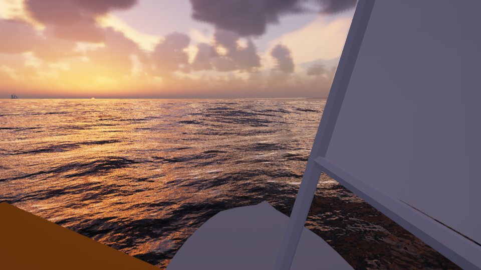 Sonnenaufgang neben der Maritim Seebrücke (Regiebuch „Ein Tag am Strand“) | 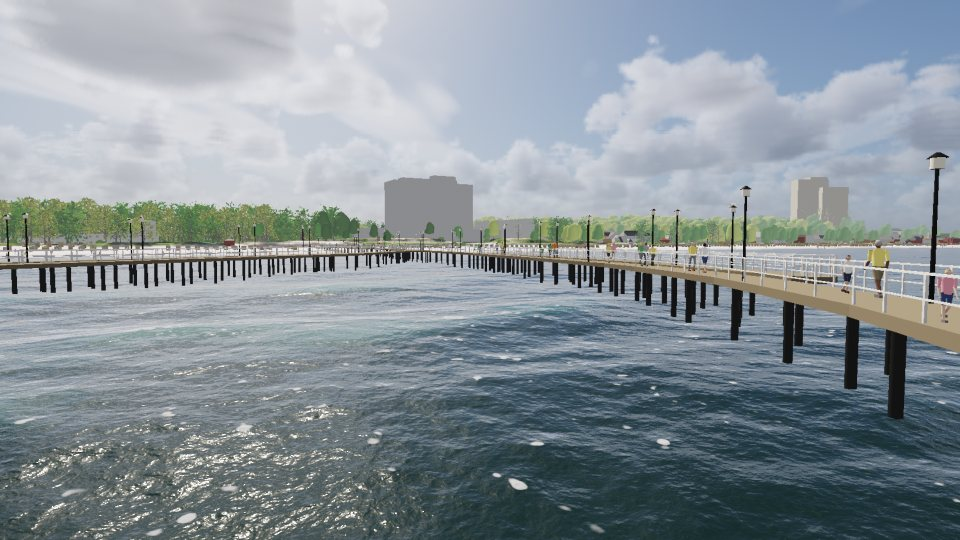 Die Seebrücke mit der Schleife („Mein Weg zum Strand“) |
| 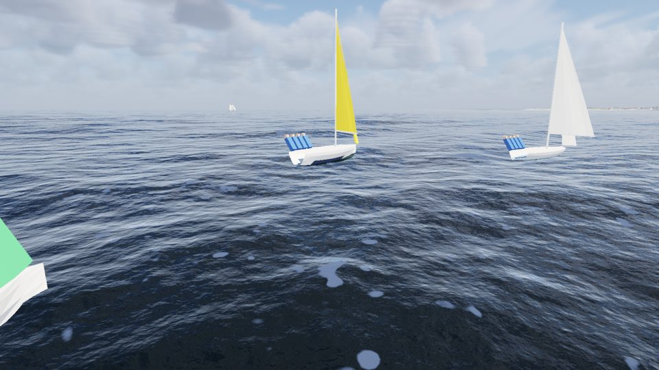 J/70 vor dem Start der Regatta, Segel aus `com.dan.sail` | 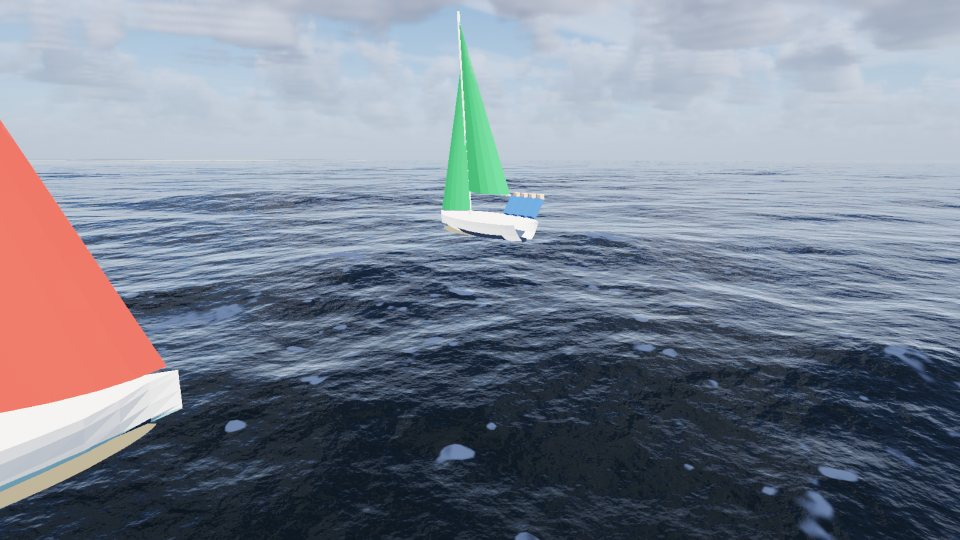 Die Kreuz zur Luvtonne, Wellen aus `com.dan.ocean` mit Kielwasser |
| 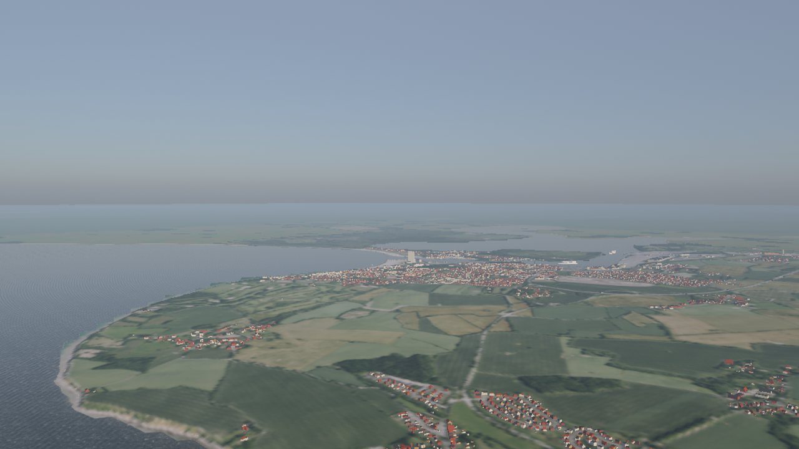 Vogelschau über das Brodtener Ufer bis Travemünde (DGM1, DOP20) | 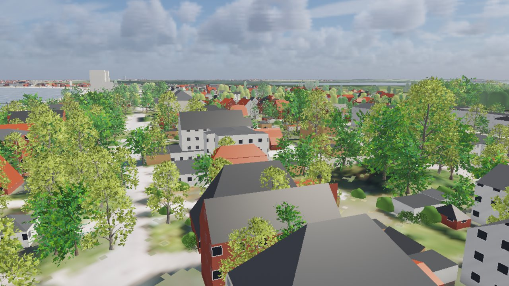 Niendorf: Häuser aus LOD2, Bäume aus dem bDOM |
| 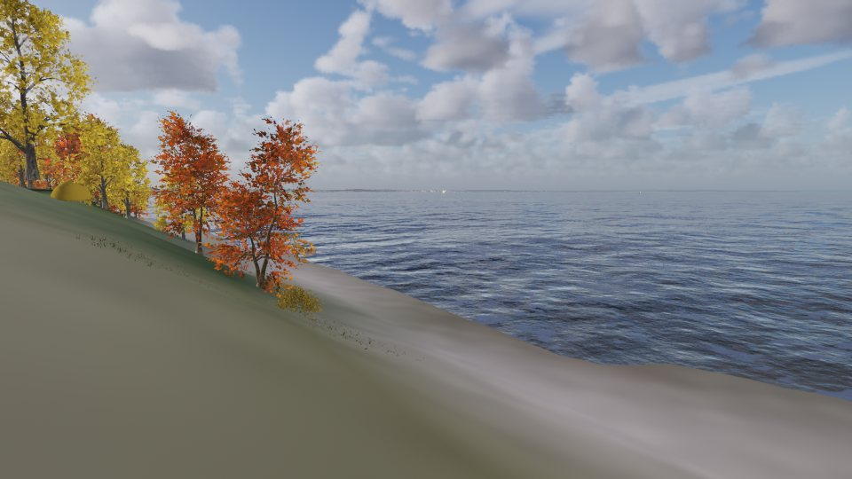 Buchen am Brodtener Ufer im Herbst („Ein Jahr an der Bucht“) | 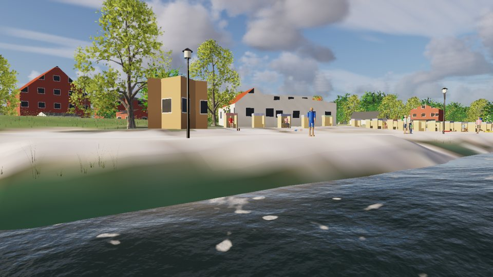 Sommerabend im Niendorfer Hafen |
| 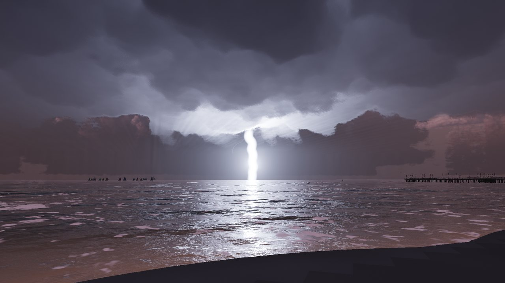 Gewitter über der Bucht, der Blitz schlägt ins Meer | 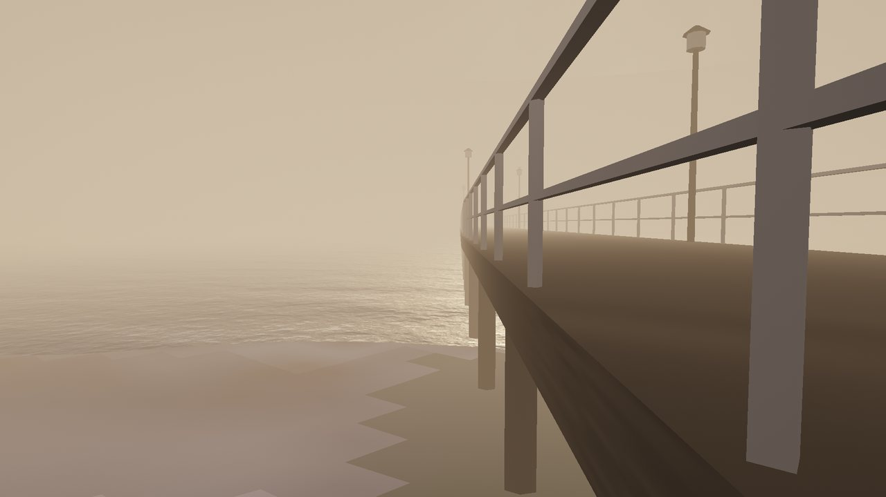 Seenebel an der Seebrücke |
| 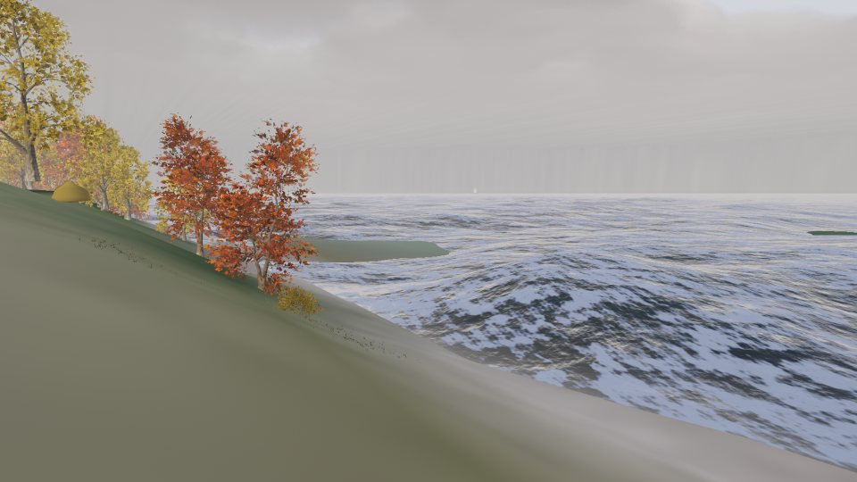 Sturmflut am 21.10.2023: Brecher vor dem Steilufer | 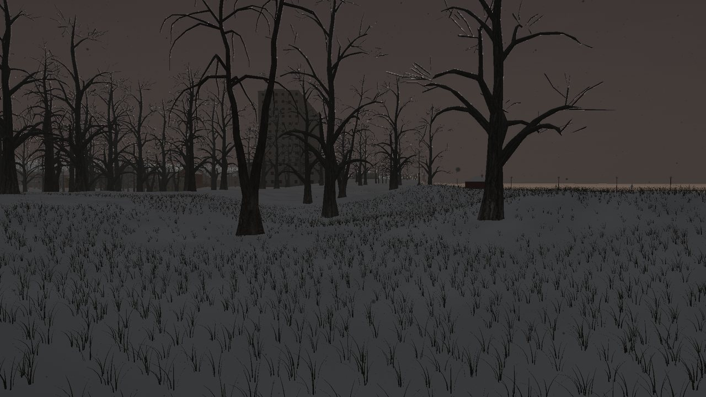 Schnee im Kurpark |
|  Abendrot über der Lübecker Bucht | 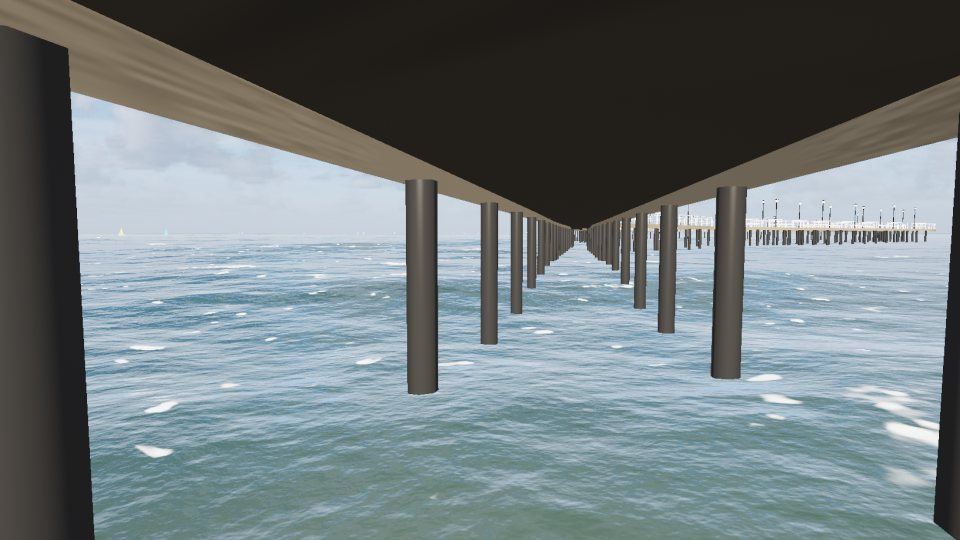 Unter der Seebrücke |

Alle Bilder hat die Szene in Echtzeit auf einer AMD Radeon 680M gerechnet, Stufe Mittel, ohne Nachbearbeitung. Die vollständigen Blätter liegen in `docs/status/`: Regiebücher, Wetter, Sturmflut, Feuerwerk und Hörproben.

## Die Packages

Timmendorf nutzt aus `lib/Renderer.jar` diese Packages. Jedes hat sein README im Projekt Renderer, unter `src/com/dan/<package>/README.md`.

| Package | Inhalt in Timmendorf |
|---|---|
| `com.dan.sail` | **Neu für Timmendorf.** Segelboote vom Optimisten bis zur Passat: Polaren aus der Aerodynamik, Krängung, Wende und Halse, Kentern, Regatta mit Startverfahren und Wegerecht |
| `com.dan.cloth` | **Neu.** Tuch nach XPBD: Flaggen, festgemachte Segel |
| `com.dan.wake` | **Neu.** Kielwasser nach Kelvin, Schaum, Schwell am Ufer (Compute-Shader) |
| `com.dan.firework` | **Neu.** Feuerwerk: Sterne mit Masse, Farbe aus dem Spektrum der Salze, Rauch im Wind, Zündplan der Travemünder Woche |
| `com.dan.route` | **Neu.** Wegenetze (A*, aus dem Oracle Network Data Model), Fußgänger nach Weidmann, Autos nach Greenshields, Buslinien mit Fahrplan |
| `com.dan.lamp` | **Neu.** Leuchten mit Lichtstrom und Verteilung, Lampenarten mit Spektrum, Dämmerungsschalter, Fensterlicht nach der Uhrzeit |
| `com.dan.jelly` | Ohrenquallen nach der Jahreszeit, Trift, Strandung (Phase 17) |
| `com.dan.tree` | Bäume im Wind mit Laub nach dem Datum; seit Phase 19 Rotbuche und junge Kiefer |
| `com.dan.ocean` | Die Ostsee aus einem Spektrum (JONSWAP, Streichlänge), Grund aus dem Gelände, Eingang für das Kielwasser |
| `com.dan.sky`, `com.dan.cloud` | Sonne, Mond und Sterne für die Bucht, Streuung, Belichtung wie das Auge; Cumulus mit Schatten |
| `com.dan.weather`, `rain`, `fog`, `lightning` | Wetterregie mit elf Lagen, Regen mit Ringen, Seenebel und Seerauch, Gewitter |
| `com.dan.season`, `ice`, `rime` | Das Jahr: Schnee auf Gelände, Dächern und Decks, Eis von den Rändern her, Reif |
| `com.dan.beacon` | Leuchtfeuer: Travemünde im Maritim, Molenfeuer, Leitfeuer der Trave |
| `com.dan.cliff`, `fracture` | Das Brodtener Ufer aus Geschiebemergel, Abbrüche bei der Sturmflut |
| `com.dan.spray`, `surf`, `wave`, `buoyancy` | Brecher an den Pfählen, Brandung, Schwimmen und Rollen |
| `com.dan.figure` | Menschen: Gehen, Sitzen, Liegen, Badezeug, Netz für die Menge |
| `com.dan.flock`, `com.dan.seal` | Möwen, Schwäne, Kormorane, Enten; selten ein Seehund vor der Schleife |
| `com.dan.reed`, `ground`, `dune` | Strandhafer, Schilf, Binsen und Gras um das Auge |
| `com.dan.soundscape` | Klang ohne Aufnahmen: Brandung, Fallen an den Masten, Startsignale, Fährhorn, Feuerwerk mit Laufzeit des Schalls, Stimmen und Schritte |
| `com.dan.kino` | Kino: Balken 2,39 : 1, Vor- und Abspann, Untertitel, Überblendung |
| `com.dan.store` | Datenseite: Einrichter für die Oracle-Skripte, Felder als Presets und Zustand, Datei als Rückfall |
| `com.dan.wind`, `tide`, `weathering`, `wetglass`, `mudflat`, `smoke` | Wind über dem Gelände, Pegel, Nässe; übrige Teile aus Sylt |

Die App selbst liegt in `com.dan.timmendorf`:

| Package | Inhalt |
|---|---|
| `app` | Start, Fenster (FFrame), Statuszeile |
| `scene` | Bühne, Gelände, Bauten, Bauwerke, Bewuchs, Flotte, Menschen, Verkehr, Lichter, Leben, Sturmflut, Abbruch, Regiebücher als Text |
| `gl` | Renderer mit allen Durchgängen, Shader, Qualitätsstufen, Regisseur, Klang, Unwetter |
| `camera` | Kamera, Ansichten, Fahrten |
| `wiring` | Verdrahtung der Packages: Wetterregie, Jahreszeit, Seegang |
| `data` | Datenseite: Speicher (Oracle oder Datei), Zustand, Chronik, Startdaten, Einrichten, Netz aus Oracle |
| `ui` | Startbild, Bedienfeld, HUD, Polarfenster, Programmsymbol, `Raster` für die Knöpfe |
| `tools` | Werkzeuge ohne Fenster: Aufbereitung, Tempo, Bildfolgen, Hörproben, Dauerlauf, Bildvergleich, Symbol |

## Bedienung

**Startbild:** Mit „Weiter wie zuletzt“ geht es mit dem gespeicherten Stand weiter (Vorschaubild, Datum, Lage). „Neu am 1. August“ beginnt frisch. „Im Kino“ startet ein Regiebuch. „Einrichten“ legt das Schema an. Ohne Datenbank speichert die App in `%APPDATA%\Timmendorf`.

**Bedienfeld** (rechts, 360 px, Blöcke zum Aufklappen):

| Block | Inhalt |
|---|---|
| KAMERA | Neun Ansichten, frei fliegen, kreisen, Mitfahrt im Optimisten, Begleitboot, Spitze der Regatta |
| ZEIT | Datum und Uhrzeit, Zeitraffer, Sprünge |
| WETTER | Elf Lagen, Regen, Nebel, Gewitter, Blitz von Hand, Jahreszeit, Tiere |
| WASSER | Seegang, Pegel, Sturmflut 2023 nach dem Fahrplan |
| BOOTE, REGATTA | Flotte, Kielwasser, Regatta starten, Polare des Boots |
| FEUERWERK | Zündplan, „Von selbst am 1. August um 22:45“, „Jetzt zünden“, Lichter |
| MENSCHEN | Spaziergänger, Badegäste, Verkehr |
| KLANG | Ton an, Lautstärke, Anpassung des Ohrs, acht Teile |
| REGIEBÜCHER | Buch wählen, von vorn, anhalten, im Kino zeigen; „Mein Weg zum Strand“ |
| TECHNIK | Qualitätsstufe, HUD, Shader neu laden, Foto |
| DATEN | Speichern und Laden, Presets, gemerkte Ansichten, Regiebuch-Editor, Befunde, Verbindung |

**Tasten** (F1 zeigt alle):

| Taste | Wirkung |
|---|---|
| Maus links / rechts ziehen, Rad | drehen / verschieben, zoomen |
| W A S D, Q/E, Umschalt | gleiten, ab und auf, schneller |
| F, R, Pos1 | frei fliegen, von selbst kreisen, Grundansicht |
| 1 bis 9 | Ansichten: Seebrücke, Schleife, Strandkörbe, Spülsaum, Promenade, Niendorfer Hafen, Brodtener Ufer, Hemmelsdorfer See, Vogelschau |
| O, B, G | im Optimisten mitfahren, Begleitboot, Spitze der Regatta |
| Z | Feuerwerk zünden |
| Leertaste | Uhr anhalten und weiter |
| H | HUD kurz, voll, aus (beim Start aus) |
| M, P, Strg+S | Ansicht merken, Polare des Boots, Sitzung sichern |
| F11, F12, F5 | nur die Szene, Foto nach `docs/status/`, Shader neu laden |

## Bauen und starten

- NetBeans-Projekt mit Ant, JDK 21, OpenGL 4.3. In `lib/` liegen `Renderer.jar` (im Klassenpfad vor `FStyle.jar`), JOGL mit Windows-Natives, `FStyle.jar`, `ojdbc11.jar`, `sdoapi.jar`, `sdogr.jar`, `sdonm.jar` und `sdoutl.jar`.
- In NetBeans: **Clean and Build**, dann **Run**. Hauptklasse ist `com.dan.timmendorf.app.TimmendorfApp`.
- **Ohne NetBeans:** `Timmendorf.bat` startet `dist\Timmendorf.jar` ohne Konsole. `Timmendorf_Konsole.bat` startet mit Konsole und hält bei einem Fehler an.
- **Verknüpfung:** `Verknuepfung.bat` legt „Timmendorf“ mit dem Programmsymbol auf dem Desktop an. Das Symbol (`icon/Timmendorf.ico`, im Jar in 16 bis 256 px) malt `ant symbol`.
- **Renderer geändert:** Dort zuerst „Clean and Build“, dann hier `ant renderer`. Das kopiert `../Renderer/dist/Renderer.jar` nach `lib/`. `check-packages` prüft nach jedem Übersetzen, ob alle Packages, Shader und Baumarten im Jar sind.
- **Aufbereitung:** `ant aufbereitung` (rund 15 min) liest die Rohdaten einmal nach `daten/`. Der Pfad steht in `daten/rohdaten.properties`, Vorgabe `C:\Daten\Timmendorf`. Einzelne Schritte gehen mit `-Dschritt=alkis+gelaende+bewuchs+luftbild+bauten+netz+bauwerke+inhalt`. `ant inhalt` rechnet die Prüfsummen nach. Die App liest nur `daten/`, nie die Rohdaten.

### Qualitätsstufen

| Stufe | Bild | Gelände im Kern | Bäume bis | Wofür |
|---|---|---|---|---|
| Niedrig | 67 % | 4 m | 500 m | schwache Grafik |
| **Mittel** | 85 % | 2 m | 1 km | Vorgabe: 60 Bilder/s in Full HD auf der Radeon 680M, nie unter 30 |
| Hoch | 100 % | 1 m | 1,8 km | Standbilder |
| Ultra | 100 % | 1 m | 3 km | Kino |

Seit Phase 19 folgen alle Teile der Stufe, auch Brecher, Steilufer, Segel, Leuchtfeuer, Vögel, Robbe und Klang. `ant stufen` misst alle vier in Full HD.

## Prüfen

| Aufruf | Was | Braucht |
|---|---|---|
| `ant pruefung` | Raum, Küste, Gelände, Ansichten, Uhr und Sonne, alle Teile der Szene, Regie und Kino, Datenseite, Schliff (Symbol, Startdateien, Stufen). Endet mit „ERGEBNIS: alles in Ordnung“ | nichts |
| `ant dbpruefung` | Schema TIMMENDORF: Tabellen, Startdaten, Speichern und Laden, Netze | Oracle |
| `ant dauerlauf` | 30 min ohne Fenster mit Schaltungen alle 12 s und Speichern jede Minute. Bericht in `docs/status/Dauerlauf_Phase19.txt`, `-Dminuten=…` ändert die Dauer | Grafikkarte |
| `ant stufen`, `ant tempo` | Bilder je Sekunde und Zeit jedes Durchgangs; Statusbild mit `-Dansicht=…` | Grafikkarte |
| `ant regiebuecher` | alle fünf Regiebücher bis zum Ende, je ein Blatt `docs/status/Regiebuch_….png`; `-Dbuch=Tag`, `-Dkino=an` | Grafikkarte |
| `ant bildfolge`, `ant wetterbilder`, `ant sturmflutbilder` | Feuerwerk, Wetter und Sturmflut als Bildfolgen nach `docs/status/` | Grafikkarte |
| `ant hoerproben` | neun Hörproben als WAV mit Spektrogramm nach `docs/hoerproben/` | nichts |
| `ant bildvergleich -Dprojekt=…` | Rückfluss: Bilder vorher, zwischen und nachher einer anderen Szene vergleichen | nichts |

## Datenbank

Schema TIMMENDORF auf PDBORCL (Präfix `TD_`, Benutzer aus `db/USER.sql`). Der Zugang steht in `db/db.properties`. Ist das Passwort leer, fragt das Startbild danach.

- **Teil 1, Netze** (`db/netz/`, `ant netzdb`, beim ersten Mal mit `-Dsys.passwort=…`): Fuß-, Straßen-, Bus- und Seenetz im Network Data Model, Orte, Quellen. `ant netzvergleich` prüft die Wege gegen die Datei.
- **Teil 2, Datenseite** (`db/sql/01–04`, `ant dbeinrichten`; der Einrichter löscht nie): 31 Tabellen in sechs Gruppen, Trigger, räumliche Indizes und 10 Sichten für QGIS. Dazu kommen Startdaten aus dem Code (`ant startdaten`): Regiebücher, Ansichten, Fahrten, Presets, Bootsklassen mit Polaren, Zündpläne, der Pegel der Sturmflut, Leuchtfeuer und Buslinien. `99_abbau.sql` gibt es nur von Hand.

## Rückfluss (Phase 18)

Was für Timmendorf im Renderer entstanden ist, fließt in die älteren Szenen zurück. **Thunder** bekommt Segelboote und Flaggen. **Lighthouse** bekommt die Bundesflagge am Mast und die Leuchten am Turm. **Haithabu** läuft jetzt auf `Renderer.jar` und segelt mit dem Rahsegel aus `sail`. Jeder Umbau ist mit Bildern vorher, zwischen (Rückfluss aus) und nachher belegt: `docs/rueckfluss/` und `docs/status/Bildvergleich_Phase18.txt`.

## Raum

UTM Zone 32 Nord (EPSG:25832). Der Ursprung liegt am Landende der Maritim Seebrücke bei E 616 826, N 5 985 081. Die Achsen: x nach Osten, z nach Süden (Nord = −z), y über NHN.

- Kern: 4,5 × 3,7 km zu 1 m
- Fernfeld: 18 × 14 km zu 10 m
- Fernring: rund 100 km zu 100 m
- Höhen: −50 bis +100 m NHN

## Quellen

Die Rohdaten (DGM1, bDOM, DOP20, LOD2, ALKIS, Overpass, GEBCO, BSH) liest nur das Werkzeug in `com.dan.timmendorf.tools`, und das genau einmal. Einzelheiten und Lizenzen stehen in [docs/QUELLEN.md](docs/QUELLEN.md).

Geobasisdaten © GeoBasis-DE/LVermGeo SH (Datenlizenz Deutschland – Namensnennung 2.0); © OpenStreetMap-Mitwirkende (ODbL); GEBCO Compilation Group, GEBCO 2026 Grid. Werte mit [G] im Code sind gestaltet, also begründet geschätzt und nicht gemessen.

## Werdegang

19 Phasen vom 30. bis 31.10.2026, Plan und Abnahmen im Artefakt „Timmendorf Werkbuch“. Was jede Phase gebracht hat, steht in [docs/WERDEGANG.md](docs/WERDEGANG.md).

